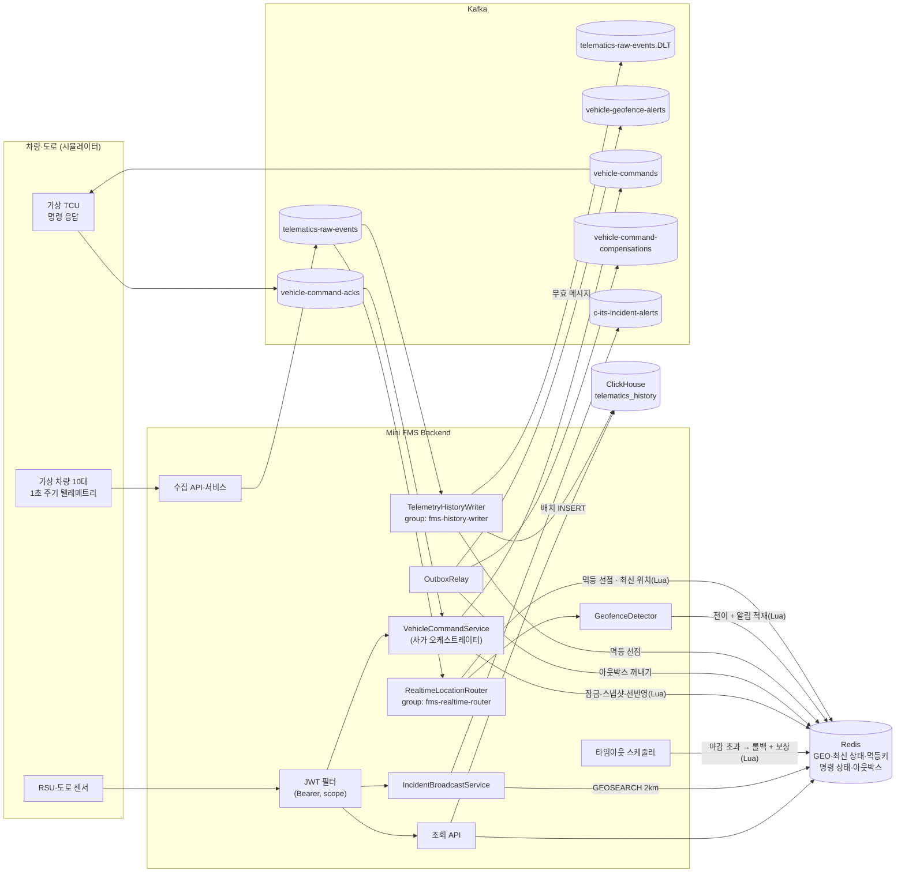
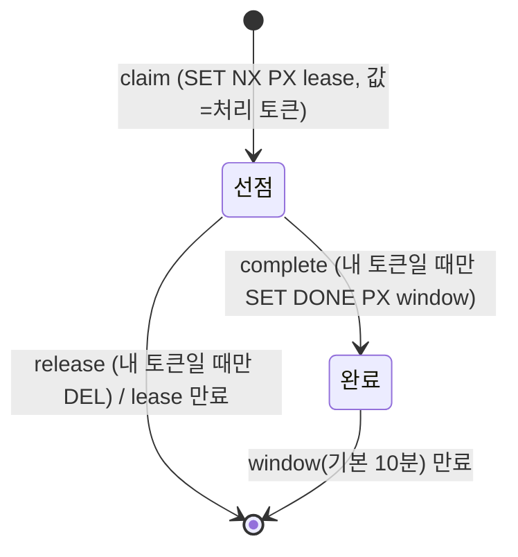
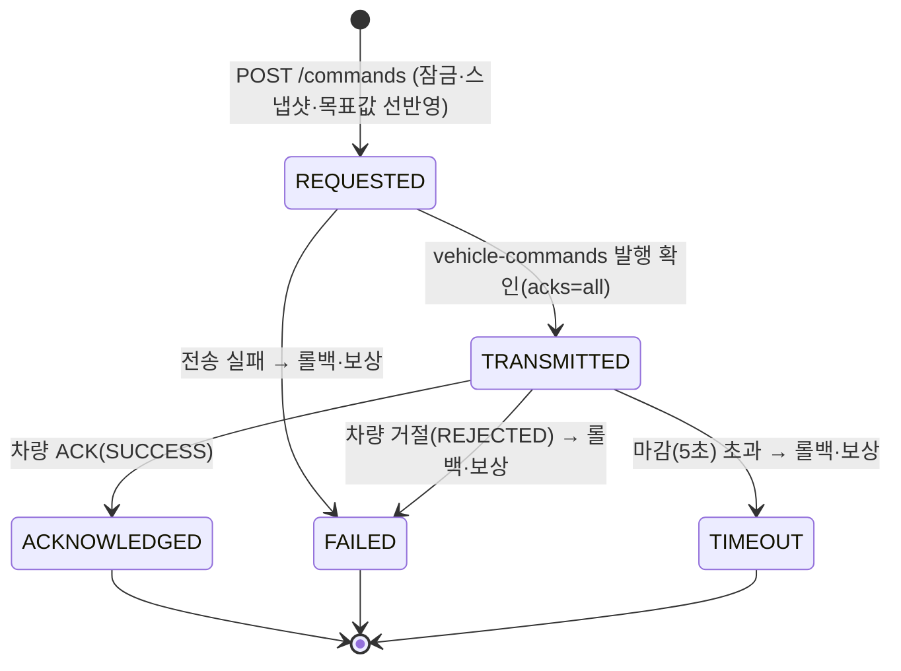
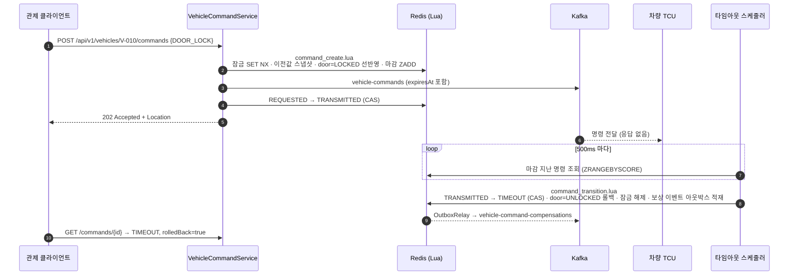

# Mini FMS Backend

차량 관제(FMS, Fleet Management System)용 백엔드 코어 파이프라인.
텔레매틱스 수집 → 실시간 위치(Redis GEO)·과거 궤적(ClickHouse) 분리 저장, 메시지 멱등 처리, 지오펜스 진입·이탈 감지,
원격 제어 명령 사가(보상 트랜잭션), C-ITS 돌발상황 전파, JWT 인증을 담았다. `docker compose` 로 인프라를 띄우고 바로 실행·시험할 수 있다.

| 영역 | 기술 |
|---|---|
| 언어·프레임워크 | Java 21, Spring Boot 3.5, Spring Kafka, Spring Data Redis(Lettuce), Spring Security(OAuth2 Resource Server) |
| 메시지 브로커 | Apache Kafka 3.9 (KRaft, ZooKeeper 없음) |
| 실시간 상태 | Redis 7.4 (GEO, Lua 스크립트) |
| 시계열 | ClickHouse 24.8 (ReplacingMergeTree) |
| 빌드·테스트 | Gradle(Kotlin DSL), JUnit 5, Testcontainers |

## 목차

1. [디렉터리 구조](#디렉터리-구조)
2. [아키텍처](#아키텍처)
3. [핵심 설계](#핵심-설계)
4. [데이터 모델](#데이터-모델)
5. [API 명세](#api-명세)
6. [로컬 실행](#로컬-실행)
7. [테스트](#테스트)
8. [한계와 확장 포인트](#한계와-확장-포인트)

## 디렉터리 구조

```
mini-fms-backend
├── build.gradle.kts / settings.gradle.kts / gradlew
├── docker-compose.yml                 # Kafka(KRaft)·Redis·ClickHouse (+ app, kafka-ui 프로필)
├── Dockerfile                         # 멀티 스테이지 빌드
└── src
    ├── main/java/com/minifms
    │   ├── MiniFmsApplication.java
    │   ├── common
    │   │   ├── config                 # Kafka 토픽·리스너 팩토리, Clock, @ConfigurationProperties
    │   │   ├── idempotency            # IdempotencyGuard: Redis 2단계(선점→완료) 멱등 처리
    │   │   ├── outbox                 # Redis 아웃박스 → Kafka 릴레이
    │   │   ├── kafka · redis · geo · metrics · web(ProblemDetail 오류 응답)
    │   ├── telematics
    │   │   ├── api                    # POST /api/v1/telematics[/batch]
    │   │   ├── ingest                 # 검증 → telematics-raw-events 발행
    │   │   ├── consumer               # RealtimeLocationRouter(Redis), TelemetryHistoryWriter(ClickHouse)
    │   │   └── history                # ClickHouse 저장소
    │   ├── vehicle                    # Redis GEO 저장소, 반경·상세·궤적 조회 API, 오래된 차량 정리
    │   ├── geofence                   # 진입·이탈 감지(히스테리시스), 상태 전이 Lua
    │   ├── command                    # 원격 제어 사가: API, 저장소(Lua), ACK 소비자, 타임아웃 스케줄러
    │   ├── incident                   # C-ITS 돌발상황 → 반경 2km 주행 차량 경고 브로드캐스트
    │   ├── security                   # JWT 검증 필터 체인, scope, 개발용 토큰 발급
    │   └── simulator                  # 가상 차량 10대(텔레메트리) + 가상 TCU(명령 응답)
    ├── main/resources
    │   ├── application.yml / application-local.yml
    │   ├── clickhouse/schema.sql
    │   └── scripts/*.lua              # 원자적 상태 변경 9개
    └── test
        ├── java/com/minifms           # Testcontainers 통합 테스트 + 단위 테스트
        └── resources/application-test.yml
```

## 아키텍처



- **수집 경로는 가볍게**: API·시뮬레이터는 검증만 하고 `telematics-raw-events` 에 싣는다(키 = vehicleId → 같은 차량은 같은 파티션에서 순서 유지).
- **소비처별 consumer group**: 실시간(Redis)과 이력(ClickHouse)을 다른 group 으로 읽는다. ClickHouse 장애가 실시간 위치 갱신을 막지 않고, 장애 대응도 다르게 한다(실시간은 제한 재시도 후 건너뜀, 이력은 버리지 않고 무기한 재시도 → lag 만 쌓임).
- **조회는 CQRS 의 조회 측**: 현재 상태는 Redis, 과거 궤적은 ClickHouse 에서 읽는다.

## 핵심 설계

### 1. 메시지 멱등성 — Redis 2단계 선점

멱등키 = `vehicleId:timestamp(ms)`. 키 하나는 아래 상태를 오간다(`IdempotencyGuard`, `scripts/idempotency_*.lua`).



| claim 결과 | 의미 | 소비자 동작 |
|---|---|---|
| `CLAIMED` | 이번 시도가 선점 | 처리 후 complete, 실패 시 release |
| `DUPLICATE` | 이미 DONE, 또는 같은 배치 안에서 앞서 나온 메시지 | 버림(지표 `fms.telematics.duplicates`) |
| `IN_FLIGHT` | 다른 시도가 선점 중(리밸런스 직후 등) | 버리지 않고 재시도(리스가 풀리면 처리) |

- "처리 전에 DONE 표시"만 하는 흔한 방식은 처리가 실패해 재전달된 메시지를 중복으로 오인해 **잃는다**. 그래서 선점과 완료를 나눴다.
- 배치 전체를 Lua 한 번(Redis 왕복 1회)으로 선점한다. complete·release 는 토큰을 비교해, 리스가 만료돼 다른 시도가 다시 선점한 키를 건드리지 않는다.
- 소비처마다 namespace 를 따로 둔다("완료"는 그 소비처가 반영했다는 뜻이므로).
- **2중 방어**: 윈도우(10분) 밖의 늦은 재전송은 ClickHouse `ReplacingMergeTree(ORDER BY vehicle_id, event_time)` 가 병합 때 합친다. 궤적 조회는 `FINAL` 로 한다. 실시간 쪽은 "더 최신일 때만 갱신" 규칙이 과거 중복을 무시한다.

### 2. 실시간 위치 — Redis GEO + 순서 보장

- `scripts/location_update.lua`: 저장된 `timestamp` 보다 **최신일 때만** `GEOADD` + 최신 상태 해시 + `last-seen` 을 원자적으로 갱신한다. 늦게 도착한 과거 좌표가 최신 위치를 덮어쓰지 않는다. (`opsForGeo().add` 를 직접 쓰지 않고 Lua 로 감싼 이유)
- 반경 조회: `GEOSEARCH FROMLONLAT … BYRADIUS … WITHDIST ASC` → `last-seen`(ZMSCORE) 으로 **활성 차량**(기본 60초 안에 수신)만 남김 → 최신 상태를 파이프라인 한 번으로 읽는다.
- 10분 넘게 수신이 없는 차량은 주기적으로 GEO 인덱스에서 뺀다(`evict_stale.lua`, 조회·삭제 원자적).

### 3. 지오펜스 진입·이탈 — 히스테리시스 + 아웃박스

```
거리 ≤ radius                → 안 (ENTER 후보)
거리 > radius + hysteresis   → 밖 (EXIT 후보)
그 사이(기본 30m 완충 구간)   → 상태 유지 — 경계에서 GPS 가 흔들려 알림이 반복(flapping)되는 것을 막는다
```

- 이전 상태 = Redis 집합 `fms:geofence:{id}:inside`. `SADD`/`SREM` 의 반환값(실제 변경 수)으로 전이를 판단한다.
- **상태 전이와 알림 적재를 한 Lua 로**: 집합을 바꾸고 Kafka 발행이 실패하면 알림을 영영 잃는다(집합엔 들어갔는데 ENTER 없음). 그래서 `geofence_transition.lua` 가 전이와 함께 Redis 아웃박스(`fms:outbox`)에 알림을 넣고, `OutboxRelay` 가 Kafka 로 at-least-once 발행한다(소비자는 `alertId` 로 중복 제거).
- 최신 위치를 실제로 갱신한 이벤트만 판정하므로, 지연 도착한 과거 좌표가 지오펜스 상태를 되돌리지 않는다.

### 4. 원격 제어 명령 — 사가(오케스트레이션)와 보상





- **로컬 트랜잭션 = Lua 스크립트**: 생성(잠금·스냅샷·선반영·마감 등록)과 보상(상태 전이·롤백·잠금 해제·보상 이벤트 적재)이 각각 원자적이라, 중간에 프로세스가 죽어도 상태가 어긋나지 않는다.
- **compare-and-set 전이**: ACK 와 타임아웃이 동시에 와도 먼저 반영된 쪽 하나만 이긴다. 인스턴스가 여러 대여도 한 명령은 한 번만 보상된다.
- **차량당 진행 중 명령 1개**(409 Conflict): 롤백할 "이전 값"이 다른 명령에 의해 흐트러지지 않게 한다. 잠금에는 TTL(마감 + 10초)을 둬 스케줄러가 멈춰도 영구히 잠기지 않는다.
- **expiresAt**: 단말은 마감이 지난 명령을 실행하지 않는다 — 서버가 이미 롤백한 뒤 늦게 실행되는 것을 막는다. 그래도 늦은 ACK 가 오면 상태는 그대로 두고 `fms.command.late_acks` 지표와 경고 로그로 운영 확인을 요청한다.

### 5. C-ITS 돌발상황 전파

`POST /api/v1/incidents` (RSU·도로 센서 게이트웨이) → `IncidentBroadcastService`

1. `incidentId` 로 멱등 선점(같은 `IdempotencyGuard`) — RSU 재전송 시 경고를 다시 보내지 않는다.
2. Redis `GEOSEARCH` 로 사고 지점 **반경 2km**(설정 `fms.incident.alert-radius-km`)의 활성 차량을 찾고, 시동이 꺼진(`OFF`) 차량은 뺀다. 신호 대기(`IDLE`) 차량은 위험 구간에 있으므로 포함한다.
3. 차량마다 경고 한 건씩 `c-its-incident-alerts` 로 발행(키 = vehicleId, 차량별 V2X 푸시 게이트웨이가 자기 파티션만 읽도록). 거리 기반 안내 문구와 유효 시간(`expiresAt`, 기본 10분)을 담는다.
4. 발행이 실패하면 선점을 풀고 503 → RSU 가 재시도한다(이미 받은 차량은 `incidentId` 로 중복 표시를 거른다).

### 6. API 인증 — JWT (Spring Security Resource Server)

- `BearerTokenAuthenticationFilter` 가 `Authorization: Bearer <JWT>` 를 꺼내 **HS256 서명·만료(exp/nbf, 시계 오차 60초)·발급자(iss)** 를 검증한다. 세션은 만들지 않는다.
- 권한은 토큰의 `scope` 클레임(공백 구분)으로 준다.

| scope | 허용 |
|---|---|
| `fleet:read` | `GET /api/v1/**`, `/actuator/**`(health·info 제외) |
| `vehicle:control` | `POST /api/v1/vehicles/{id}/commands` |
| `telematics:write` | `POST /api/v1/telematics[/batch]` |
| `incident:write` | `POST /api/v1/incidents` |

- 토큰 없음·서명 불일치·만료·발급자 불일치 → **401**, scope 부족 → **403**, 그 밖의 경로는 거부(deny by default).
- 서명 키는 `FMS_JWT_SECRET`(32바이트 이상). 비어 있으면 **기동하지 않는다**(fail-closed). `local` 프로필만 개발용 키와 토큰 발급 API(`POST /api/v1/auth/dev-token`)를 켠다. 운영에서는 외부 IdP 가 발급하고 이 앱은 검증만 한다.

## 데이터 모델

### Kafka 토픽 (파티션 6, 키 = vehicleId)

| 토픽 | 생산자 → 소비자 | 보존 |
|---|---|---|
| `telematics-raw-events` | 수집 API·시뮬레이터 → 실시간 라우터, 이력 기록기 | 3일 |
| `telematics-raw-events.DLT` | 이력 기록기(무효 메시지 원본 + 사유 헤더) | 14일 |
| `vehicle-geofence-alerts` | 아웃박스 릴레이 → (알림 서비스) | 7일 |
| `vehicle-commands` | 명령 서비스 → 차량 TCU | 1일 |
| `vehicle-command-acks` | 차량 TCU → 명령 ACK 소비자 | 1일 |
| `vehicle-command-compensations` | 아웃박스 릴레이 → (고객 앱 푸시·감사 로그) | 7일 |
| `c-its-incident-alerts` | 돌발상황 서비스 → (V2X 푸시 게이트웨이) | 1일 |

### Redis 키

| 키 | 타입 | 내용 |
|---|---|---|
| `fms:vehicles:geo` | GEO(zset) | 차량 최신 위치 인덱스 |
| `fms:vehicles:last-seen` | zset | 마지막 수신 시각(score) — 활성 판정·정리 |
| `fms:vehicle:{id}:latest` | hash | 최신 텔레메트리(TTL 7일) |
| `fms:vehicle:{id}:shadow` | hash | 제어 상태(door, engine) |
| `fms:vehicle:{id}:command-lock` | string | 진행 중 commandId(TTL) |
| `fms:command:{id}` | hash | 명령 상태(TTL 24시간) |
| `fms:command:deadlines` | zset | 응답 마감(score) |
| `fms:geofence:{id}:inside` | set | 지오펜스 안 차량 |
| `fms:dedup:{namespace}:{key}` | string | 멱등키(토큰 또는 DONE) |
| `fms:outbox` / `fms:outbox:dead` | list | 발행 대기 이벤트 / 해석 불가 항목 |

### ClickHouse

```sql
CREATE TABLE IF NOT EXISTS telematics_history
(
    vehicle_id    LowCardinality(String),
    event_time    DateTime64(3, 'UTC'),
    latitude      Float64,
    longitude     Float64,
    speed         Float32,
    battery_soc   Float32,
    engine_status LowCardinality(String),
    ingested_at   DateTime64(3, 'UTC') DEFAULT now64(3)
)
ENGINE = ReplacingMergeTree(ingested_at)   -- 같은 (vehicle_id, event_time) 은 병합 때 하나로
PARTITION BY toYYYYMMDD(event_time)         -- 보존 기간이 지난 파티션을 통째로 삭제
ORDER BY (vehicle_id, event_time)           -- 차량별 시간 범위 조회에 맞춘 정렬 키
TTL toDateTime(event_time) + INTERVAL 90 DAY;
```

앱이 기동할 때 `spring.sql.init` 으로 만든다. 배치 소비자가 한 번에 최대 500건을 INSERT 한다(작은 INSERT 를 자주 하면 part 가 늘어난다).

## API 명세

오류 응답은 RFC 9457 Problem Details(`application/problem+json`)다.

| 메서드·경로 | scope | 설명 | 주요 응답 |
|---|---|---|---|
| `POST /api/v1/telematics` | `telematics:write` | 텔레메트리 1건 수집 | 202 `{accepted}`, 400 |
| `POST /api/v1/telematics/batch` | `telematics:write` | 최대 1,000건 묶음 수집 | 202, 400 |
| `GET /api/v1/vehicles/nearby?lat&lng&radiusKm[&limit]` | `fleet:read` | 반경 안 활성 차량(가까운 순) | 200, 400 |
| `GET /api/v1/vehicles/{id}` | `fleet:read` | 최신 상태 + 활성 여부 + 제어 상태 | 200, 404 |
| `GET /api/v1/vehicles/{id}/track[?from&to&limit]` | `fleet:read` | 과거 궤적(기본 최근 1시간, 최대 7일) | 200, 400 |
| `GET /api/v1/geofences` | `fleet:read` | 지오펜스와 안에 있는 차량 | 200 |
| `POST /api/v1/vehicles/{id}/commands` | `vehicle:control` | 원격 제어(`DOOR_LOCK`·`DOOR_UNLOCK`·`ENGINE_STOP`) | 202 + Location, 404, 409 |
| `GET /api/v1/vehicles/{id}/commands/{commandId}` | `fleet:read` | 명령 상태 | 200, 404 |
| `POST /api/v1/incidents` | `incident:write` | 돌발상황 보고 → 반경 2km 경고 전파 | 202 `{recipients, vehicleIds, duplicate}` |
| `POST /api/v1/auth/dev-token` | 없음(`local` 프로필만) | 개발용 토큰 발급 | 200 |
| `GET /actuator/health` | 없음 | 헬스 체크 | 200 |
| `GET /actuator/metrics/{name}` | `fleet:read` | 지표(`fms.telematics.duplicates` 등) | 200 |

텔레메트리 본문(Kafka 메시지와 같은 모양):

```json
{
  "vehicleId": "V-001",
  "latitude": 37.5665,
  "longitude": 126.9780,
  "speed": 42.5,
  "batterySoc": 87.2,
  "engineStatus": "ON",
  "timestamp": 1795590000000
}
```

`vehicleId` 는 `[A-Za-z0-9_-]`, 위도는 Redis GEO 범위(±85.05112878), `timestamp` 는 epoch ms 이며 서버 시각보다 5분 넘게 앞서면 거부한다.

## 로컬 실행

필요한 것: JDK 21, Docker.

```bash
# 1) 인프라(Kafka·Redis·ClickHouse)
docker compose up -d
docker compose ps          # 셋 다 healthy

# 2) 앱(local 프로필: 개발용 JWT 키·토큰 발급 API, 시뮬레이터 차량 10대가 1초마다 발행)
./gradlew bootRun
```

- 포트가 이미 쓰이고 있으면 바꿔 띄운다: `REDIS_PORT=6380 docker compose up -d` 후 `REDIS_PORT=6380 ./gradlew bootRun` (`KAFKA_PORT`, `CLICKHOUSE_PORT`, `APP_PORT` 도 같다).
- 앱까지 컨테이너로: `docker compose --profile app up -d --build`
- Kafka UI: `docker compose --profile tools up -d kafka-ui` → http://localhost:8090
- 시뮬레이터 끄기: `FMS_SIMULATOR_ENABLED=false ./gradlew bootRun`
- 정리: `docker compose down -v`

시뮬레이터 차량은 서울 물류센터(37.5665, 126.9780) 주변 원형 경로를 돌며 반경 1km 지오펜스를 넘나든다(데모용으로 이동 거리 5배 가속).
`V-009` 는 명령을 거절하고, `V-010` 은 응답하지 않는다(보상 시연용).

### curl 예시

```bash
# 토큰 발급(local 프로필) — scopes 를 비우면 4개 모두
TOKEN=$(curl -s -X POST localhost:8080/api/v1/auth/dev-token \
  -H 'Content-Type: application/json' -d '{"subject":"operator-1"}' | jq -r .accessToken)
AUTH="Authorization: Bearer $TOKEN"

# 토큰 없이 → 401
curl -i "localhost:8080/api/v1/vehicles/nearby?lat=37.5665&lng=126.9780&radiusKm=2"

# 반경 2km 안 활성 차량
curl -s "localhost:8080/api/v1/vehicles/nearby?lat=37.5665&lng=126.9780&radiusKm=2&limit=3" -H "$AUTH" | jq
# {"latitude":37.5665,"longitude":126.978,"radiusKm":2.0,"count":3,
#  "vehicles":[{"vehicleId":"V-006","latitude":37.562268,"longitude":126.979529,"distanceKm":0.49,
#               "speed":42.6,"batterySoc":76.7,"engineStatus":"ON","lastSeenAt":"2026-11-25T07:05:57.414Z"}, ...]}

# 지오펜스 안 차량
curl -s localhost:8080/api/v1/geofences -H "$AUTH" | jq

# 텔레메트리 직접 수집
curl -s -X POST localhost:8080/api/v1/telematics -H "$AUTH" -H 'Content-Type: application/json' \
  -d "{\"vehicleId\":\"V-100\",\"latitude\":37.5651,\"longitude\":126.9895,\"speed\":30.5,\"batterySoc\":77.0,\"engineStatus\":\"ON\",\"timestamp\":$(date +%s)000}"
# {"accepted":1}

# 원격 제어: 정상(ACKNOWLEDGED) / 거절(FAILED) / 무응답(TIMEOUT)
curl -s -X POST localhost:8080/api/v1/vehicles/V-001/commands -H "$AUTH" -H 'Content-Type: application/json' -d '{"type":"DOOR_LOCK"}' | jq
# {"commandId":"5fe5ed29-…","vehicleId":"V-001","type":"DOOR_LOCK","status":"TRANSMITTED",
#  "previousValue":"UNLOCKED","targetValue":"LOCKED","deadlineAt":"…","rolledBack":false}
curl -s -X POST localhost:8080/api/v1/vehicles/V-010/commands -H "$AUTH" -H 'Content-Type: application/json' -d '{"type":"DOOR_LOCK"}' | jq -r .commandId
# 5초 안에 같은 차량에 또 보내면 409 {"inFlightCommandId": "…"}
sleep 6
curl -s localhost:8080/api/v1/vehicles/V-010/commands/<commandId> -H "$AUTH" | jq
# {"status":"TIMEOUT","failureReason":"NO_ACK_WITHIN_5000MS","rolledBack":true, ...}
curl -s localhost:8080/api/v1/vehicles/V-010 -H "$AUTH" | jq .controlState
# {"door":"UNLOCKED","engine":"ON"}   ← 선반영했던 LOCKED 가 롤백됨

# 보상 이벤트 확인
docker exec fms-kafka /opt/kafka/bin/kafka-console-consumer.sh --bootstrap-server localhost:9092 \
  --topic vehicle-command-compensations --from-beginning --timeout-ms 3000
# {"eventId":"…","commandId":"…","vehicleId":"V-010","type":"DOOR_LOCK","failedStatus":"TIMEOUT",
#  "reason":"NO_ACK_WITHIN_5000MS","field":"door","restoredValue":"UNLOCKED","revertedValue":"LOCKED", ...}

# C-ITS 돌발상황: 물류센터 지점 낙하물 → 반경 2km 주행 차량에 경고
curl -s -X POST localhost:8080/api/v1/incidents -H "$AUTH" -H 'Content-Type: application/json' \
  -d "{\"incidentId\":\"INC-20261125-0001\",\"type\":\"ROAD_DEBRIS\",\"latitude\":37.5665,\"longitude\":126.9780,\"sourceId\":\"RSU-SEOUL-017\",\"occurredAt\":$(date +%s)000}"
# {"incidentId":"INC-20261125-0001","duplicate":false,"recipients":10,"vehicleIds":["V-008","V-005", ...]}
# 같은 incidentId 재전송 → {"duplicate":true,"recipients":0,"vehicleIds":[]}
docker exec fms-kafka /opt/kafka/bin/kafka-console-consumer.sh --bootstrap-server localhost:9092 \
  --topic c-its-incident-alerts --from-beginning --max-messages 1
# {"alertId":"…","incidentId":"INC-20261125-0001","vehicleId":"V-008","type":"ROAD_DEBRIS","distanceMeters":460,
#  "message":"도로 낙하물 발생: 약 460m 앞 구간 주의 운전","expiresAt":"…", ...}

# 지오펜스 진입·이탈 알림
docker exec fms-kafka /opt/kafka/bin/kafka-console-consumer.sh --bootstrap-server localhost:9092 \
  --topic vehicle-geofence-alerts --from-beginning --max-messages 2

# 과거 궤적(ClickHouse)
curl -s "localhost:8080/api/v1/vehicles/V-001/track?from=$(date -u -v-5M +%Y-%m-%dT%H:%M:%SZ)" -H "$AUTH" | jq '.count, .points[-1]'

# 멱등 처리 지표: 시뮬레이터가 5% 확률로 보낸 중복이 소비처마다 걸러진다
curl -s "localhost:8080/actuator/metrics/fms.telematics.duplicates?tag=sink:history" -H "$AUTH" | jq .measurements
docker exec fms-clickhouse clickhouse-client --user fms --password fms_local -d fms \
  -q "SELECT count() AS raw, uniqExact(vehicle_id, event_time) AS uniq FROM telematics_history"
# raw = uniq (병합 전에도 중복 행이 없다)
```

(`date -v-5M` 은 macOS 문법이다. Linux 는 `date -u -d '-5 min' +%Y-%m-%dT%H:%M:%SZ`.)

## 테스트

```bash
./gradlew test
```

Testcontainers 가 Kafka·Redis·ClickHouse 를 한 번 띄우고 모든 통합 테스트가 같은 Spring 컨텍스트를 쓴다(Docker 필요, 약 30초).

| 테스트 | 확인하는 것 |
|---|---|
| `VehicleLocationIT` | GEO 반경 조회(1km·3km, 가까운 순, 거리), 비활성 제외, 과거 좌표가 최신 위치를 덮지 않음, 정리 작업, 반경 API·검증(400) |
| `TelematicsPipelineIT` | Kafka → Redis·ClickHouse 반영, **중복 메시지가 두 저장소에 한 번만**(ClickHouse 병합을 멈춘 채 행 수 확인), 깨진·무효 메시지가 파이프라인을 막지 않음, 지연 이벤트, 수집 API, 궤적 API 시각 왕복 |
| `IdempotencyGuardIT` | 배치 내 중복, 윈도우 만료, IN_FLIGHT, 남의 토큰으로 해제·확정 불가, 리스 만료 후 재선점 |
| `GeofenceDetectionIT` | ENTER·EXIT 각 1회, 완충 구간·재전송·지연 좌표 무시 |
| `VehicleCommandSagaIT` | ACKNOWLEDGED / TIMEOUT(롤백·보상 이벤트·잠금 해제) / FAILED(거절) / 409 / 404 / 400 |
| `IncidentBroadcastIT` | 반경 2km 주행 차량만(IDLE 포함, OFF·반경 밖 제외), 재보고 시 재전파 없음, scope 403 |
| `SecurityIT` | 토큰 없음·만료·위조 서명·다른 발급자 401, scope 부족 403, 헬스 공개, 테스트 프로필에서 토큰 발급 API 닫힘 |
| `GeoDistanceTest`, `SimulatedFleetTest` | 거리 계산, 시뮬레이터 경로가 지오펜스 경계를 넘나듦, ENGINE_STOP 반영 |

## 한계와 확장 포인트

- **Redis Cluster**: Lua 스크립트가 여러 키를 함께 다루므로 단일 Redis(또는 Sentinel) 전제다. Cluster 로 가려면 같은 스크립트의 키에 hash tag(`{vehicleId}`)를 붙여 한 슬롯에 모으고, 전역 키(GEO 인덱스·마감 zset·아웃박스)는 샤딩하거나 스크립트 밖으로 뺀다.
- **아웃박스 릴레이**는 잠금을 가진 인스턴스 하나만 돈다. 처리량이 더 필요하면 Redis Streams + consumer group 이나 DB 아웃박스 + CDC(Debezium)로 바꾼다.
- **지오펜스 수**: 이벤트마다 모든 펜스와 거리를 잰다. 펜스가 많아지면 펜스 중심 GEO 인덱스로 후보를 먼저 추린다(또는 H3 셀 색인).
- **ClickHouse 쓰기 경로**: 소비자 배치당 한 번 INSERT 한다. 처리량이 더 크면 Kafka 엔진 테이블 + Materialized View 로 ClickHouse 가 직접 소비하게 하고, 1분 집계 MV(차량별 평균 속도·이동 거리)를 더한다.
- **멱등 윈도우**는 10분이다. 단말이 더 오래 버퍼링했다가 보내는 경우는 ReplacingMergeTree 가 최종적으로 합치고, 조회는 FINAL 로 정확하다(병합 전 집계 쿼리는 `uniqExact`·`FINAL` 을 써야 한다).
- **JWT**: 데모를 위해 HS256 공유 키를 쓴다. 운영에서는 IdP(Keycloak 등)의 RS256 + JWKS(`spring.security.oauth2.resourceserver.jwt.issuer-uri`)로 바꾸고, 단말은 mTLS·단말 인증서로 따로 인증한다.
