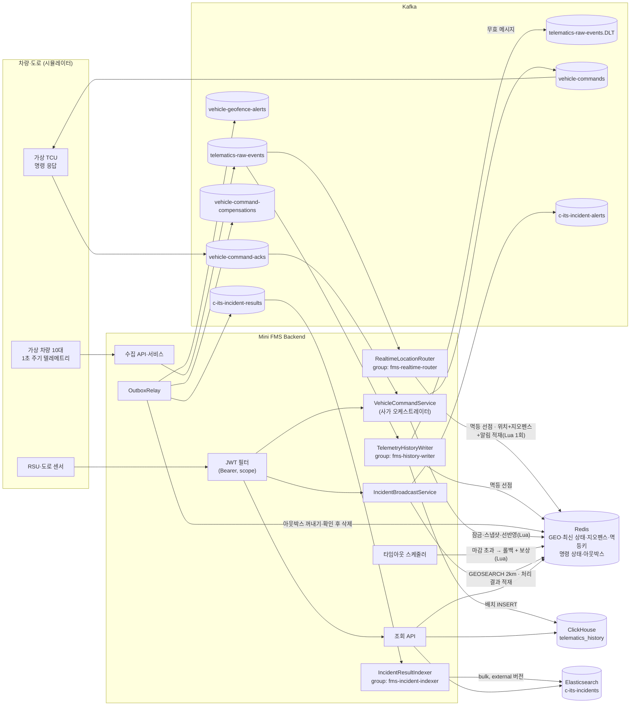
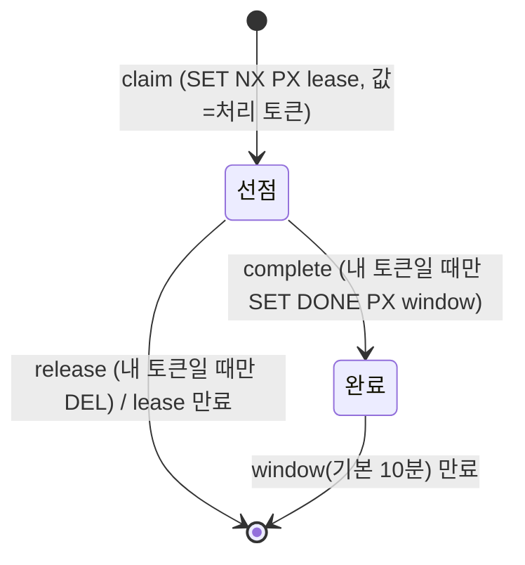
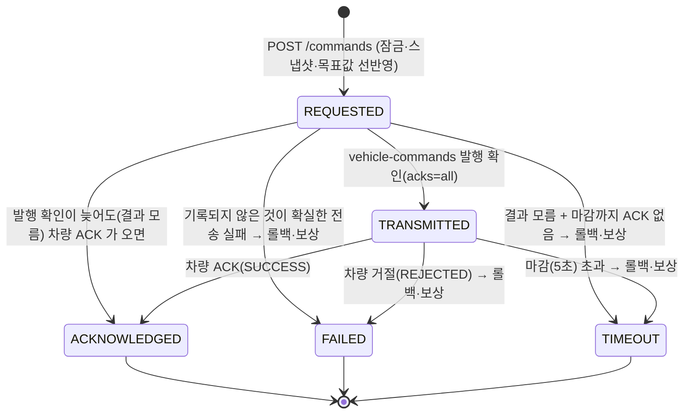
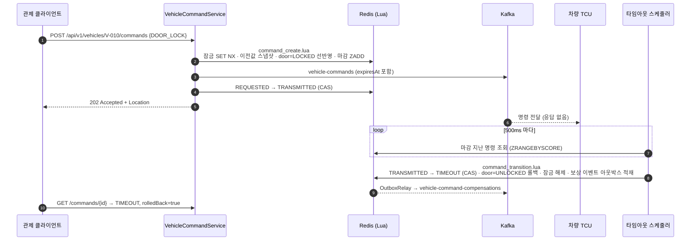
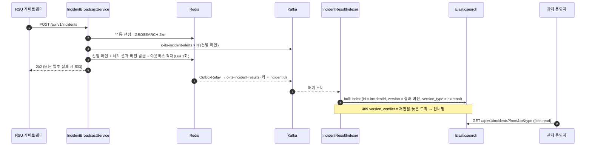

# Mini FMS Backend

차량 관제(FMS, Fleet Management System)와 자율협력주행(C-ITS)용 백엔드 코어 파이프라인.
텔레매틱스 수집 → 실시간 위치(Redis GEO)·과거 궤적(ClickHouse) 분리 저장, 메시지 멱등 처리, 지오펜스 진입·이탈 감지,
원격 제어 명령 사가(보상 트랜잭션), C-ITS 돌발상황 전파와 관제 이력 검색(Elasticsearch), JWT 인증을 담았다.

| 영역 | 기술 |
|---|---|
| 언어·프레임워크 | Java 21, Spring Boot 3.5, Spring Kafka, Spring Data Redis(Lettuce), Spring Security(OAuth2 Resource Server) |
| 메시지 브로커 | Apache Kafka 3.9 (KRaft, ZooKeeper 없음) |
| 실시간 상태 | Redis 7.4 (GEO, Lua 스크립트) |
| 시계열 | ClickHouse 24.8 (ReplacingMergeTree) |
| 관제 이력 검색 | Elasticsearch 8.18 (Java API Client, external 버전) |
| 빌드·테스트 | Gradle(Kotlin DSL), JUnit 5, Testcontainers |

## 3분 데모

필요한 것: JDK 21, Docker, `jq`. 포트 9092·6379·8123·9200·8080 을 쓴다(이미 쓰는 포트가 있으면 [로컬 실행](#로컬-실행)처럼 바꿔 띄운다).
아래 블록을 순서대로 한 터미널에 붙여 넣으면 된다.

```bash
# 0) 인프라(Kafka·Redis·ClickHouse·Elasticsearch) + 앱(시뮬레이터 차량 10대가 1초마다 위치를 보낸다)
docker compose up -d --wait
./gradlew bootRun > /tmp/mini-fms.log 2>&1 &
until curl -sf localhost:8080/actuator/health > /dev/null; do sleep 2; done; sleep 3

# 개발용 토큰(local 프로필에서만 열리는 발급 API)
TOKEN=$(curl -s -X POST localhost:8080/api/v1/auth/dev-token -H 'Content-Type: application/json' -d '{"subject":"demo"}' | jq -r .accessToken)
AUTH="Authorization: Bearer $TOKEN"
```

**① 최신 위치 조회** (Redis GEO + 최신 상태 해시)

```bash
curl -s localhost:8080/api/v1/vehicles/V-010 -H "$AUTH" | jq -c '{vehicleId: .latest.vehicleId, latitude: .latest.latitude, longitude: .latest.longitude, speed: .latest.speed, measuredAt: .latest.timestamp, controlState}'
# {"vehicleId":"V-010","latitude":37.57491,"longitude":126.96747,"speed":59.1,"measuredAt":"2026-11-25T07:41:40.099Z","controlState":{"door":"UNLOCKED","engine":"ON"}}
```

**② 응답하지 않는 차량에 원격 제어 → TIMEOUT 과 롤백** (V-010 은 시뮬레이터에서 무응답 차량)

```bash
CID=$(curl -s -X POST localhost:8080/api/v1/vehicles/V-010/commands -H "$AUTH" -H 'Content-Type: application/json' -d '{"type":"DOOR_LOCK"}' | jq -r .commandId)
curl -s localhost:8080/api/v1/vehicles/V-010 -H "$AUTH" | jq -c .controlState
# {"door":"LOCKED","engine":"ON"}        ← 요청 즉시 목표 값을 선반영
sleep 6
curl -s localhost:8080/api/v1/vehicles/V-010/commands/$CID -H "$AUTH" | jq -c '{status, failureReason, rolledBack}'
# {"status":"TIMEOUT","failureReason":"NO_ACK_WITHIN_5000MS","rolledBack":true}
curl -s localhost:8080/api/v1/vehicles/V-010 -H "$AUTH" | jq -c .controlState
# {"door":"UNLOCKED","engine":"ON"}      ← 5초 안에 응답이 없어 이전 값으로 롤백
```

**③ 보상 이벤트 확인** (vehicle-command-compensations)

```bash
docker exec fms-kafka /opt/kafka/bin/kafka-console-consumer.sh --bootstrap-server localhost:9092 \
  --topic vehicle-command-compensations --from-beginning --timeout-ms 5000 2>/dev/null | grep "$CID" | jq -c '{commandId, failedStatus, reason, field, restoredValue, revertedValue}'
# {"commandId":"cc5250b0-…","failedStatus":"TIMEOUT","reason":"NO_ACK_WITHIN_5000MS","field":"door","restoredValue":"UNLOCKED","revertedValue":"LOCKED"}
```

**④ 돌발상황 접수 → 반경 2km 경고 → 관제 이력 조회** (Redis GEO → Kafka → Elasticsearch)

```bash
INCIDENT_ID=INC-$(date +%s)
curl -s -X POST localhost:8080/api/v1/incidents -H "$AUTH" -H 'Content-Type: application/json' \
  -d "{\"incidentId\":\"$INCIDENT_ID\",\"type\":\"ROAD_DEBRIS\",\"latitude\":37.5665,\"longitude\":126.9780,\"sourceId\":\"RSU-SEOUL-017\",\"occurredAt\":$(date +%s)000,\"description\":\"2차로 낙하물\"}" | jq -c
# {"incidentId":"INC-1795592512","duplicate":false,"recipients":10,"vehicleIds":["V-006","V-009", …]}

docker exec fms-kafka /opt/kafka/bin/kafka-console-consumer.sh --bootstrap-server localhost:9092 \
  --topic c-its-incident-alerts --from-beginning --timeout-ms 5000 2>/dev/null | grep "$INCIDENT_ID" | head -2 | jq -c '{vehicleId, distanceMeters, message}'
# {"vehicleId":"V-009","distanceMeters":611,"message":"도로 낙하물 발생: 약 611m 앞 구간 주의 운전"}

sleep 2   # 처리 결과 → Kafka → 색인 소비자 → Elasticsearch (비동기)
curl -s localhost:8080/api/v1/incidents/$INCIDENT_ID -H "$AUTH" | jq -c
# {"incidentId":"INC-1795592512","type":"ROAD_DEBRIS","sourceId":"RSU-SEOUL-017","latitude":37.5665,"longitude":126.978,
#  "occurredAt":"2026-11-25T07:41:52Z","status":"COMPLETED","targetCount":10,"confirmedCount":10,"failedCount":0, …}
curl -s "localhost:8080/api/v1/incidents?from=$(date -u +%Y-%m-%dT00:00:00Z)&to=$(date -u +%Y-%m-%dT23:59:59Z)&type=ROAD_DEBRIS" -H "$AUTH" \
  | jq -c '{totalElements, totalPages, first: .content[0] | {incidentId, status, targetCount, confirmedCount}}'
# {"totalElements":1,"totalPages":1,"first":{"incidentId":"INC-1795592512","status":"COMPLETED","targetCount":10,"confirmedCount":10}}
```

**⑤ Elasticsearch 를 멈춰도 접수·경고는 계속되고, 복구 뒤 이력이 채워진다**

```bash
docker compose stop elasticsearch
INCIDENT_ID2=INC-$(date +%s)-ES
curl -s -X POST localhost:8080/api/v1/incidents -H "$AUTH" -H 'Content-Type: application/json' \
  -d "{\"incidentId\":\"$INCIDENT_ID2\",\"type\":\"ACCIDENT\",\"latitude\":37.5665,\"longitude\":126.9780,\"sourceId\":\"RSU-SEOUL-017\",\"occurredAt\":$(date +%s)000}" | jq -c '{incidentId, recipients}'
# {"incidentId":"INC-1795592522-ES","recipients":10}       ← 접수·경고 발행 정상
curl -s -o /dev/null -w '이력 조회: %{http_code}\n' localhost:8080/api/v1/incidents/$INCIDENT_ID2 -H "$AUTH"
# 이력 조회: 503                                            ← 검색만 장애
docker compose up -d --wait elasticsearch
until [ "$(curl -s -o /dev/null -w '%{http_code}' localhost:8080/api/v1/incidents/$INCIDENT_ID2 -H "$AUTH")" = 200 ]; do sleep 2; done
curl -s localhost:8080/api/v1/incidents/$INCIDENT_ID2 -H "$AUTH" | jq -c '{incidentId, status, targetCount, confirmedCount}'
# {"incidentId":"INC-1795592522-ES","status":"COMPLETED","targetCount":10,"confirmedCount":10}   ← 밀린 결과 색인
```

정리: `kill $(lsof -t -iTCP:8080 -sTCP:LISTEN)` 후 `docker compose down -v`.

## 목차

1. [디렉터리 구조](#디렉터리-구조)
2. [아키텍처](#아키텍처)
3. [핵심 설계](#핵심-설계)
4. [데이터 모델](#데이터-모델)
5. [API 명세](#api-명세)
6. [로컬 실행](#로컬-실행)
7. [테스트](#테스트)
8. [남아 있는 장애 시나리오와 확장 포인트](#남아-있는-장애-시나리오와-확장-포인트)
9. [후속 요구사항 — 돌발상황 관제 이력](#후속-요구사항--돌발상황-관제-이력)

## 디렉터리 구조

```
mini-fms-backend
├── build.gradle.kts / settings.gradle.kts / gradlew
├── docker-compose.yml                 # Kafka(KRaft)·Redis·ClickHouse·Elasticsearch (+ app, kafka-ui 프로필)
├── Dockerfile                         # 멀티 스테이지 빌드
└── src
    ├── main/java/com/minifms
    │   ├── MiniFmsApplication.java
    │   ├── common
    │   │   ├── config                 # Kafka 토픽·리스너 팩토리, Clock, @ConfigurationProperties
    │   │   ├── idempotency            # IdempotencyGuard: Redis 2단계(선점→완료) 멱등 처리
    │   │   ├── outbox                 # Redis 아웃박스 → Kafka 릴레이
    │   │   ├── kafka · redis · geo · metrics · web(ProblemDetail 오류 응답)
    │   ├── telematics
    │   │   ├── api                    # POST /api/v1/telematics[/batch]
    │   │   ├── ingest                 # 검증 → telematics-raw-events 발행
    │   │   ├── consumer               # RealtimeLocationRouter(Redis), TelemetryHistoryWriter(ClickHouse)
    │   │   └── history                # ClickHouse 저장소
    │   ├── vehicle                    # Redis GEO 저장소(위치+지오펜스 원자 갱신), 반경·상세·궤적 조회 API
    │   ├── geofence                   # 진입·이탈 판정(히스테리시스)
    │   ├── command                    # 원격 제어 사가: API, 저장소(Lua), ACK 소비자, 타임아웃 스케줄러
    │   ├── incident                   # C-ITS 돌발상황: 반경 2km 경고 브로드캐스트, 처리 결과 기록
    │   │   └── history                # Elasticsearch 색인 소비자·저장소·검색 서비스
    │   ├── security                   # JWT 검증 필터 체인, scope, 개발용 토큰 발급
    │   └── simulator                  # 가상 차량 10대(텔레메트리) + 가상 TCU(명령 응답)
    ├── main/resources
    │   ├── application.yml / application-local.yml
    │   ├── clickhouse/schema.sql
    │   └── scripts/*.lua              # 원자적 상태 변경 10개
    └── test
        ├── java/com/minifms           # Testcontainers 통합 테스트 + 단위 테스트
        └── resources/application-test.yml
```

## 아키텍처



- **수집 경로는 가볍게**: API·시뮬레이터는 검증만 하고 `telematics-raw-events` 에 싣는다(키 = vehicleId → 같은 차량은 같은 파티션에서 순서 유지).
- **소비처별 consumer group**: 실시간(Redis)·이력(ClickHouse)·관제 이력 색인(Elasticsearch)이 서로 다른 group 이다. 저장소 하나의 장애가 다른 경로를 막지 않는다.
- **조회는 CQRS 의 조회 측**: 현재 상태는 Redis, 과거 궤적은 ClickHouse, 돌발상황 이력은 Elasticsearch 에서 읽는다.

## 핵심 설계

### 1. 메시지 멱등성 — Redis 2단계 선점

멱등키 = `vehicleId:timestamp(ms)`. 키 하나는 아래 상태를 오간다(`IdempotencyGuard`, `scripts/idempotency_*.lua`).



| claim 결과 | 의미 | 소비자 동작 |
|---|---|---|
| `CLAIMED` | 이번 시도가 선점 | 처리 후 complete, 실패 시 release |
| `DUPLICATE` | 이미 DONE, 또는 같은 배치 안에서 앞서 나온 메시지 | 버림(지표 `fms.telematics.duplicates`) |
| `IN_FLIGHT` | 다른 시도가 선점 중(리밸런스 직후 등) | 버리지 않고 재시도(리스가 풀리면 처리) |

- "처리 전에 DONE 표시"만 하는 흔한 방식은 처리가 실패해 재전달된 메시지를 중복으로 오인해 **잃는다**. 그래서 선점과 완료를 나눴다.
- 배치 전체를 Lua 한 번(Redis 왕복 1회)으로 선점한다. complete·release 는 토큰을 비교해, 리스가 만료돼 다른 시도가 다시 선점한 키를 건드리지 않는다.
- 같은 배치 안의 중복은 "이번 실행에서 이미 본 키"로 가린다. Redis 클라이언트(Lettuce)가 재연결하며 선점 스크립트를 다시 보내도 자기 선점을 중복으로 오인해 메시지를 버리지 않는다.
- 소비처마다 namespace 를 따로 둔다("완료"는 그 소비처가 반영했다는 뜻이므로).
- **2중 방어**: 윈도우(10분) 밖의 늦은 재전송은 ClickHouse `ReplacingMergeTree(ORDER BY vehicle_id, event_time)` 가 병합 때 합친다. 궤적 조회는 `FINAL` 로 한다.

**측정 시각 범위와 이력 저장**

- 받을 수 있는 측정 시각은 **과거 7일 ~ 미래 30초**다(`fms.telematics.max-past-age`·`max-future-skew`). 각각 단말의 오프라인 버퍼 기간과 시계 오차에 대한 가정이며 설정으로 바꾼다.
  범위가 없으면 날짜가 100일 넘게 퍼진 묶음 하나를 ClickHouse 가 거부(`Too many partitions for single INSERT block`)하고, 이력 소비자가 같은 배치를 무기한 재시도해 그 파티션의 이력 기록이 멈춘다.
- 이력은 **UTC 날짜(= ClickHouse 파티션)별로 INSERT** 하고, 저장한 날짜의 멱등키는 바로 DONE 으로 확정한다. 뒤 날짜가 실패해 배치가 재처리돼도 앞 날짜는 다시 저장하지 않는다(병합 전에도 중복 행 없음).
- DB 오류는 DLT 로 보내지 않고 재시도한다. 검증을 통과한 레코드는 타입·범위가 맞아 레코드 때문에 INSERT 가 결정적으로 실패할 근거가 없기 때문이다. DLT 에는 해석·검증에 실패한 레코드만 보낸다.
- DLT 발행이 확인되지 않으면 예외로 **배치의 오프셋을 확정하지 않는다**. 재처리 때 정상 레코드는 이미 DONE 이라 다시 저장되지 않고 무효 레코드만 다시 DLT 로 간다.

### 2. 실시간 위치와 지오펜스 — 한 번의 원자 연산

`scripts/location_update.lua` 하나가 아래를 함께 한다.

1. 저장된 `timestamp` 보다 **최신일 때만** 진행(늦게 도착한 과거 좌표는 위치도 지오펜스도 바꾸지 않는다).
2. `GEOADD` + 최신 상태 해시 + `last-seen` 갱신.
3. 지오펜스별 전이 후보를 `SADD`/`SREM` 으로 적용하고, 실제로 바뀐 것만 알림을 아웃박스에 넣는다.

위치 저장과 지오펜스 판정을 따로 하면 그 사이 실패했을 때 Kafka 재전달 메시지는 "이미 반영된 시각"이라 판정을 건너뛰고,
**위치만 갱신된 채 진입 알림이 사라진다**. 한 스크립트로 합쳐 둘 다 반영되거나 둘 다 반영되지 않게 했다
(회귀 테스트 `RealtimeRedeliveryIT`: 위치 저장 직후 한 번 실패 → 재전달 → ENTER 정확히 1건).

지오펜스 판정 규칙(히스테리시스):

```
거리 ≤ radius                → 안 (ENTER 후보)
거리 > radius + hysteresis   → 밖 (EXIT 후보)
그 사이(기본 30m 완충 구간)   → 후보 없음 — 경계에서 GPS 가 흔들려 알림이 반복(flapping)되는 것을 막는다
```

반경 조회: `GEOSEARCH FROMLONLAT … BYRADIUS … WITHDIST ASC` → `last-seen`(ZMSCORE) 으로 **활성 차량**(기본 60초 안에 수신)만 남김 → 최신 상태를 파이프라인 한 번으로 읽는다.

### 3. 아웃박스 → Kafka 릴레이

지오펜스 알림·명령 보상·돌발상황 처리 결과는 상태 변경과 같은 Lua 스크립트(또는 같은 요청) 안에서 Redis 아웃박스(`fms:outbox`)에 넣고, `OutboxRelay` 가 Kafka 로 at-least-once 발행한다.

- 잠금을 가진 인스턴스 하나만 릴레이한다. 앞에서부터 발행이 확인된 항목만 지운다.
- **삭제는 `outbox_ack.lua` 로만 한다**: "아직 잠금 소유자인가 + 목록 앞부분이 내가 발행한 항목(SHA-1)과 같은가"를 원자적으로 확인한 뒤 같은 만큼만 `LTRIM`.
  발행 확인을 기다리는 사이 잠금이 만료돼 다른 릴레이가 같은 항목을 처리·삭제한 경우, "읽은 건수만큼 LTRIM" 은 **그다음의 미발행 항목을 지운다**
  (회귀 테스트 `OutboxRelayIT`).
- 중복 발행은 가능하다(at-least-once). 소비자는 `alertId`·`eventId`·`incidentId + version` 으로 거른다.

### 4. 원격 제어 명령 — 사가(오케스트레이션)와 보상





- **로컬 트랜잭션 = Lua 스크립트**: 생성(잠금·스냅샷·선반영·마감 등록)과 보상(상태 전이·롤백·잠금 해제·보상 이벤트 적재)이 각각 원자적이다.
- **compare-and-set 전이**: ACK 와 타임아웃이 동시에 와도 종료 상태는 한 번만 확정된다(`VehicleCommandUncertaintyIT`: 경합 30건에서 종료 확정·제어 상태·보상 이벤트가 명령마다 일치).
- **차량당 진행 중 명령 1개**(409 Conflict): 롤백할 "이전 값"이 다른 명령에 의해 흐트러지지 않게 한다. 잠금 TTL(마감 + 10초)로 영구 잠김을 막는다.
- **전송 결과를 모르면 보상하지 않는다**: 발행 확인 시간 초과·재시도 가능한 Kafka 오류는 "실패"가 아니라 "브로커가 받았는지 모름"이다.
  프로듀서는 계속 재전송하므로 이미 차량에 전달됐을 수 있다. 명령을 진행 중(REQUESTED)으로 두고 ACK 면 ACKNOWLEDGED, 마감까지 없으면 스케줄러가 TIMEOUT 으로 보상한다.
  기록되지 않은 것이 확실한 실패(직렬화·크기·권한 오류)만 바로 FAILED 로 보상한다(`fms.command.transmit_unknown` 지표).
- **차량 실행 마감(expiresAt) = 서버 마감 − 1.5초**(`fms.command.device-execution-margin`, ACK 전달 지연에 대한 가정): 마감 직전에 실행한 명령의 ACK 가 서버 마감 전에 도착할 여유다.
- **ACK 소비**: Redis 연결 장애·시간 초과처럼 복구될 수 있는 오류만 무기한 재시도한다(그동안 ACK 를 버리지 않는다). 그 밖의 오류와 해석할 수 없는 메시지는 로그를 남기고 넘어가 뒤따르는 ACK 를 막지 않는다.
- **보상의 의미**: 보상은 서버가 기록한 제어 상태(shadow)를 이전 값으로 되돌리는 것이다. 실제 차량 상태는 차량이 보고해야 확인된다.
  TIMEOUT 확정 뒤 성공 ACK 가 늦게 오면 서버 기록과 실제 차량이 다를 수 있어, `fms.command.late_acks` 지표와 경고 로그로 확인을 요청한다(자동 보정은 후속 과제).

### 5. C-ITS 돌발상황 전파

`POST /api/v1/incidents` (RSU·도로 센서 게이트웨이, `incident:write`) → `IncidentBroadcastService`

1. `incidentId` 로 멱등 선점 — RSU 재전송 시 경고를 다시 보내지 않는다(응답 `duplicate: true`).
2. Redis `GEOSEARCH` 로 돌발 지점 **반경 2km** 의 활성 차량을 찾고 시동 꺼짐(`OFF`)은 뺀다. 신호 대기(`IDLE`)는 위험 구간에 있으므로 포함한다.
3. 차량마다 경고 한 건씩 `c-its-incident-alerts` 로 발행(키 = vehicleId)하고, **건별로 브로커 확인(acks=all)을 기다려 센다**.
   확인 건수는 "발행 마감(`publish-timeout`, 3초) 안에 브로커가 수신을 확인한 수"다. 마감은 보내기 전에 잡고, 브로커 장애로 send 가 즉시 실패하면
   남은 차량에는 보내지 않는다(브로커 장애 때 요청 하나가 "대상 수 × max.block.ms" 동안 스레드를 붙잡지 않게). 레코드 한 건만의 거절이면 나머지는 계속 보낸다.
4. 처리 결과(대상 수·확인 건수·실패 건수·상태)를 아웃박스에 남긴다 → `c-its-incident-results`. 이때 **선점을 아직 가지고 있는지** 같은 Lua 안에서 확인한다.
   처리가 오래 걸려 선점이 만료되고 RSU 재시도가 이어받았다면, 늦게 끝난 처리는 결과를 남기지 않고 409 를 돌려준다(이어받은 처리의 결과가 최신).
5. 하나라도 확인되지 않으면 선점을 풀고 503 → RSU 가 재시도한다. 재시도는 더 큰 버전의 새 결과를 남긴다(이미 받은 차량은 `incidentId` 로 중복 표시를 거른다).

| 처리 상태 | 조건 | 접수 API |
|---|---|---|
| `NO_TARGETS` | 대상 0대 | 202 (`recipients: 0`) |
| `COMPLETED` | 대상 전부 발행 확인 | 202 |
| `PARTIALLY_FAILED` | 일부만 확인 | 503(재시도 요청) |
| `FAILED` | 하나도 확인 안 됨(브로커 장애) | 503(재시도 요청) |

### 6. 돌발상황 관제 이력 — Kafka → Elasticsearch 비동기 색인



- **문서 ID = `incidentId`, external 버전 = 처리 결과 버전**: Elasticsearch 는 저장된 것보다 큰 버전만 받는다.
  같은 결과의 재전달은 문서를 늘리지 않고, **늦게 도착한 이전 결과는 최신 결과를 덮어쓰지 않는다**. 소비자 쪽 순서 보장이나 잠금이 필요 없다.
- **버전 = max(현재 시각 ms, 마지막 버전 + 1)**, 선점 확인·버전 발급·아웃박스 적재를 한 Lua 로 한다(`incident_record_result.lua`).
  Redis 가 발급 순서를 직렬화하므로 같은 밀리초에도 앞선 결과보다 크고, 키가 사라져도 시각 기반이라 과거로 돌아가지 않는다.
  버전 순서가 처리 순서와 어긋날 수 있는 경우(선점이 만료된 처리가 늦게 끝나 기록)는 선점 확인으로 막는다.
- **처리 결과를 Kafka 에 직접 보내지 않고 아웃박스를 거친다**: 브로커 장애로 경고가 전부 실패(`FAILED`)한 처리도 이력에 남아야 하는데, 그 순간 Kafka 는 받지 못한다.
- **별칭 색인**: 검색·쓰기는 별칭 `c-its-incidents` 로, 실제 색인은 `c-its-incidents-v1`(strict 매핑)이다. 쓰기는 `require_alias` 로 해서
  색인이 사라지면(볼륨 없는 재생성·운영자 삭제) Elasticsearch 가 동적 매핑으로 자동 생성하지 않고 실패하게 한다. 색인 소비자는 그때 매핑을 지정해 다시 만든다.
  매핑을 바꿀 때는 `-v2` 로 재색인한 뒤 별칭만 옮긴다.
- **Elasticsearch 장애**
  - 접수·경고 발행 경로는 Elasticsearch 를 거치지 않는다 → 계속 동작.
  - 색인 소비자는 bulk 실패 시 오프셋을 커밋하지 않고 무기한 재시도(간격 최대 5초). 복구되면 밀린 결과를 처리한다(`c-its-incident-results` 보존 7일).
  - 검색·상세 API 는 503 + `Retry-After: 5`(연결 실패·시간 초과·429·5xx). 그 밖의 Elasticsearch 거절(4xx)은 다시 해도 같으므로 500 이다.
  - Elasticsearch 헬스 지표는 앱 전체 상태(`/actuator/health`)에서 뺐다. 검색 저장소 장애로 앱이 트래픽에서 빠지면 접수까지 멈추기 때문이다.
  - 색인은 첫 색인 때 매핑(`dynamic: strict`)을 지정해 만든다. 앱 기동은 Elasticsearch 에 의존하지 않는다.
- **검색**: 발생 시각 `[from, to)` 필터 + 선택 유형(`term`), 정렬 `occurredAt desc, incidentId asc`(같은 시각에도 순서 고정), `page`·`size` 페이지.
  기간 최대 31일, `size` 최대 100, `page × size` 는 10,000 이하(Elasticsearch `max_result_window`).
  ID 조회는 바로 반영되고, 검색은 refresh(기본 1초) 뒤에 보인다.

### 7. API 인증 — JWT (Spring Security Resource Server)

- `BearerTokenAuthenticationFilter` 가 `Authorization: Bearer <JWT>` 를 꺼내 **HS256 서명·만료(exp/nbf, 시계 오차 60초)·발급자(iss)** 를 검증한다. 세션은 만들지 않는다.
- 권한은 토큰의 `scope` 클레임(공백 구분)으로 준다.

| scope | 허용 |
|---|---|
| `fleet:read` | `GET /api/v1/**`(관제 이력 검색 포함), `/actuator/**`(health·info 제외) |
| `vehicle:control` | `POST /api/v1/vehicles/{id}/commands` |
| `telematics:write` | `POST /api/v1/telematics[/batch]` |
| `incident:write` | `POST /api/v1/incidents` |

- 토큰 없음·서명 불일치·만료·`exp` 없음(영구 토큰)·발급자 불일치 → **401**, scope 부족 → **403**, 그 밖의 경로는 거부(deny by default).
- 서명 키는 `FMS_JWT_SECRET`(32바이트 이상). 비어 있으면 **기동하지 않는다**. `local` 프로필만 개발용 키와 토큰 발급 API 를 켠다.

## 데이터 모델

### Kafka 토픽 (파티션 6)

| 토픽 | 키 | 생산자 → 소비자 | 보존 |
|---|---|---|---|
| `telematics-raw-events` | vehicleId | 수집 API·시뮬레이터 → 실시간 라우터, 이력 기록기 | 3일 |
| `telematics-raw-events.DLT` | vehicleId | 이력 기록기(무효 메시지 원본 + 사유 헤더) | 14일 |
| `vehicle-geofence-alerts` | vehicleId | 아웃박스 릴레이 → (알림 서비스) | 7일 |
| `vehicle-commands` | vehicleId | 명령 서비스 → 차량 TCU | 1일 |
| `vehicle-command-acks` | vehicleId | 차량 TCU → 명령 ACK 소비자 | 1일 |
| `vehicle-command-compensations` | vehicleId | 아웃박스 릴레이 → (고객 앱 푸시·감사 로그) | 7일 |
| `c-its-incident-alerts` | vehicleId | 돌발상황 서비스 → (V2X 푸시 게이트웨이) | 1일 |
| `c-its-incident-results` | incidentId | 아웃박스 릴레이 → 이력 색인 소비자 | 7일 |

### Redis 키

| 키 | 타입 | 내용 |
|---|---|---|
| `fms:vehicles:geo` | GEO(zset) | 차량 최신 위치 인덱스 |
| `fms:vehicles:last-seen` | zset | 마지막 수신 시각(score) — 활성 판정·정리 |
| `fms:vehicle:{id}:latest` | hash | 최신 텔레메트리(TTL 7일) |
| `fms:vehicle:{id}:shadow` | hash | 제어 상태(door, engine) |
| `fms:vehicle:{id}:command-lock` | string | 진행 중 commandId(TTL) |
| `fms:command:{id}` | hash | 명령 상태(TTL 24시간) |
| `fms:command:deadlines` | zset | 응답 마감(score) |
| `fms:geofence:{id}:inside` | set | 지오펜스 안 차량 |
| `fms:incident:{id}:result-version` | string | 돌발상황 처리 결과의 마지막 버전(TTL 30일) |
| `fms:dedup:{namespace}:{key}` | string | 멱등키(토큰 또는 DONE) |
| `fms:outbox` / `fms:outbox:dead` | list | 발행 대기 이벤트 / 해석 불가 항목 |

### ClickHouse

```sql
CREATE TABLE IF NOT EXISTS telematics_history
(
    vehicle_id    LowCardinality(String),
    event_time    DateTime64(3, 'UTC'),
    latitude      Float64,
    longitude     Float64,
    speed         Float32,
    battery_soc   Float32,
    engine_status LowCardinality(String),
    ingested_at   DateTime64(3, 'UTC') DEFAULT now64(3)
)
ENGINE = ReplacingMergeTree(ingested_at)   -- 같은 (vehicle_id, event_time) 은 병합 때 하나로
PARTITION BY toYYYYMMDD(event_time)         -- 보존 기간이 지난 파티션을 통째로 삭제
ORDER BY (vehicle_id, event_time)           -- 차량별 시간 범위 조회에 맞춘 정렬 키
TTL toDateTime(event_time) + INTERVAL 90 DAY;
```

### Elasticsearch 색인 — 별칭 `c-its-incidents` → `c-its-incidents-v1` (문서 ID = incidentId)

| 필드 | 타입 | 내용 |
|---|---|---|
| `incidentId`, `type`, `sourceId`, `status` | keyword | 유형·출처·처리 상태 필터 |
| `occurredAt`, `processedAt` | date | 발생 시각(검색·정렬 기준), 처리 시각 |
| `location` | geo_point | 돌발 지점(공간 검색 확장용) |
| `targetCount`, `confirmedCount`, `failedCount` | integer | 대상 수, 브로커 발행 확인 수, 미확인 수 |
| `version` | long | 처리 결과 버전(= 문서 external 버전) |
| `description` | text | 보고 내용 |

## API 명세

오류 응답은 RFC 9457 Problem Details(`application/problem+json`)다.

| 메서드·경로 | scope | 설명 | 주요 응답 |
|---|---|---|---|
| `POST /api/v1/telematics` | `telematics:write` | 텔레메트리 1건 수집 | 202 `{accepted}`, 400 |
| `POST /api/v1/telematics/batch` | `telematics:write` | 최대 1,000건 묶음 수집 | 202, 400 |
| `GET /api/v1/vehicles/nearby?lat&lng&radiusKm[&limit]` | `fleet:read` | 반경 안 활성 차량(가까운 순) | 200, 400 |
| `GET /api/v1/vehicles/{id}` | `fleet:read` | 최신 상태 + 활성 여부 + 제어 상태 | 200, 404 |
| `GET /api/v1/vehicles/{id}/track[?from&to&limit]` | `fleet:read` | 과거 궤적(기본 최근 1시간, 최대 7일) | 200, 400 |
| `GET /api/v1/geofences` | `fleet:read` | 지오펜스와 안에 있는 차량 | 200 |
| `POST /api/v1/vehicles/{id}/commands` | `vehicle:control` | 원격 제어(`DOOR_LOCK`·`DOOR_UNLOCK`·`ENGINE_STOP`) | 202 + Location, 404, 409 |
| `GET /api/v1/vehicles/{id}/commands/{commandId}` | `fleet:read` | 명령 상태 | 200, 404 |
| `POST /api/v1/incidents` | `incident:write` | 돌발상황 보고 → 반경 2km 경고 전파 | 202 `{incidentId, duplicate, recipients, vehicleIds}`, 409(처리 중·선점 만료), 503(발행 미확인·저장소 장애) |
| `GET /api/v1/incidents?from&to[&type&page&size]` | `fleet:read` | 관제 이력 검색(발생 `[from,to)`, 최신순) | 200 `{content, page, size, totalElements, totalPages}`, 400, 503 |
| `GET /api/v1/incidents/{incidentId}` | `fleet:read` | 돌발상황 처리 결과 | 200, 404(색인 전), 503 |
| `POST /api/v1/auth/dev-token` | 없음(`local` 프로필만) | 개발용 토큰 발급 | 200 |
| `GET /actuator/health` | 없음 | 헬스 체크(Elasticsearch 제외) | 200 |
| `GET /actuator/metrics/{name}` | `fleet:read` | 지표 | 200 |

관제 이력 한 건:

```json
{
  "incidentId": "INC-1795592512",
  "type": "ROAD_DEBRIS",
  "sourceId": "RSU-SEOUL-017",
  "latitude": 37.5665,
  "longitude": 126.978,
  "occurredAt": "2026-11-25T07:41:52Z",
  "description": "2차로 낙하물",
  "status": "COMPLETED",
  "targetCount": 10,
  "confirmedCount": 10,
  "failedCount": 0,
  "version": 1795592512827,
  "processedAt": "2026-11-25T07:41:52.827138Z"
}
```

텔레메트리 본문(Kafka 메시지와 같은 모양): `{"vehicleId":"V-001","latitude":37.5665,"longitude":126.9780,"speed":42.5,"batterySoc":87.2,"engineStatus":"ON","timestamp":1795590000000}`.
`vehicleId` 는 `[A-Za-z0-9_-]`, 위도는 Redis GEO 범위(±85.05112878), `timestamp` 는 epoch ms 이며 과거 7일 ~ 미래 30초 밖이면 거부한다.
Redis·ClickHouse 연결 실패·시간 초과는 503(`Retry-After`), 처리하지 못한 예외는 Problem Details 형식의 500 이다.

## 로컬 실행

```bash
docker compose up -d --wait   # Kafka·Redis·ClickHouse·Elasticsearch
./gradlew bootRun             # local 프로필(개발용 JWT 키·토큰 발급 API), 시뮬레이터 켜짐
```

- 포트가 이미 쓰이고 있으면 바꿔 띄운다: `REDIS_PORT=6380 docker compose up -d --wait` 후 `REDIS_PORT=6380 ./gradlew bootRun`
  (`KAFKA_PORT`, `CLICKHOUSE_PORT`, `ELASTICSEARCH_PORT`, `APP_PORT` 도 같다. Elasticsearch 는 `ELASTICSEARCH_URIS=http://localhost:<포트>` 도 함께 준다).
- 앱까지 컨테이너로: `docker compose --profile app up -d --build`
- Kafka UI: `docker compose --profile tools up -d kafka-ui` → http://localhost:8090
- 시뮬레이터 끄기: `FMS_SIMULATOR_ENABLED=false ./gradlew bootRun`
- 정리: `docker compose down -v`

시뮬레이터 차량은 서울 물류센터(37.5665, 126.9780) 주변 원형 경로를 돌며 반경 1km 지오펜스를 넘나든다(데모용으로 이동 거리 5배 가속).
`V-009` 는 명령을 거절하고, `V-010` 은 응답하지 않는다(보상 시연용).

### 더 많은 curl 예시

[3분 데모](#3분-데모)의 `TOKEN`·`AUTH` 를 그대로 쓴다.

```bash
# 반경 2km 안 활성 차량(가까운 순)
curl -s "localhost:8080/api/v1/vehicles/nearby?lat=37.5665&lng=126.9780&radiusKm=2&limit=3" -H "$AUTH" | jq

# 지오펜스 안 차량 / 진입·이탈 알림
curl -s localhost:8080/api/v1/geofences -H "$AUTH" | jq
docker exec fms-kafka /opt/kafka/bin/kafka-console-consumer.sh --bootstrap-server localhost:9092 \
  --topic vehicle-geofence-alerts --from-beginning --max-messages 2

# 텔레메트리 직접 수집
curl -s -X POST localhost:8080/api/v1/telematics -H "$AUTH" -H 'Content-Type: application/json' \
  -d "{\"vehicleId\":\"V-100\",\"latitude\":37.5651,\"longitude\":126.9895,\"speed\":30.5,\"batterySoc\":77.0,\"engineStatus\":\"ON\",\"timestamp\":$(date +%s)000}"

# 원격 제어: 정상(ACKNOWLEDGED) / 거절(FAILED)
CID_OK=$(curl -s -X POST localhost:8080/api/v1/vehicles/V-001/commands -H "$AUTH" -H 'Content-Type: application/json' -d '{"type":"DOOR_LOCK"}' | jq -r .commandId)
CID_NG=$(curl -s -X POST localhost:8080/api/v1/vehicles/V-009/commands -H "$AUTH" -H 'Content-Type: application/json' -d '{"type":"DOOR_LOCK"}' | jq -r .commandId)
sleep 3
curl -s localhost:8080/api/v1/vehicles/V-001/commands/$CID_OK -H "$AUTH" | jq -c '{status, rolledBack}'   # ACKNOWLEDGED, false
curl -s localhost:8080/api/v1/vehicles/V-009/commands/$CID_NG -H "$AUTH" | jq -c '{status, rolledBack}'   # FAILED, true

# 과거 궤적(ClickHouse) — 최근 1시간 기본
curl -s "localhost:8080/api/v1/vehicles/V-001/track" -H "$AUTH" | jq '.count, .points[-1]'

# 멱등 처리: 시뮬레이터가 5% 확률로 보낸 중복이 걸러진다(raw = uniq)
curl -s "localhost:8080/actuator/metrics/fms.telematics.duplicates?tag=sink:history" -H "$AUTH" | jq .measurements
docker exec fms-clickhouse clickhouse-client --user fms --password fms_local -d fms \
  -q "SELECT count() AS raw, uniqExact(vehicle_id, event_time) AS uniq FROM telematics_history"

# 이력 색인 지표(반영·버린 결과 수)
curl -s "localhost:8080/actuator/metrics/fms.incident.history.indexed" -H "$AUTH" | jq .measurements
```

## 테스트

```bash
./gradlew test
```

Testcontainers 가 Kafka·Redis·ClickHouse·Elasticsearch 를 한 번 띄우고 모든 통합 테스트가 같은 Spring 컨텍스트를 쓴다(Docker 필요, 약 1분 10초).

| 테스트 | 확인하는 것 |
|---|---|
| `VehicleLocationIT` | GEO 반경 조회(1km·3km, 가까운 순, 거리), 비활성 제외, 과거 좌표가 최신 위치를 덮지 않음, 정리 작업, 반경 API·검증(400) |
| `TelematicsPipelineIT` | Kafka → Redis·ClickHouse 반영, **중복 메시지가 두 저장소에 한 번만**(병합을 멈춘 채 행 수 확인), 깨진·무효 메시지가 파이프라인을 막지 않음, 지연 이벤트, 수집 API, 궤적 시각 왕복, 측정 시각 범위(8일 전·1분 뒤 400, 6일 전·10초 뒤 202) |
| `TelemetryHistoryRetryIT` | **사흘치 중 둘째 날 저장 실패 → 재처리 → 병합 전에도 6건·궤적 6건**, **DLT 발행 미확인 → 배치 재처리 → 정상 1건·DLT 1건** |
| `RealtimeRedeliveryIT` | 위치 저장 직후 실패 → 재전달 → ENTER 알림 정확히 1건(위치·지오펜스가 한 스크립트라 그 사이 실패는 구조상 없다) |
| `IdempotencyGuardIT` | 배치 내 중복, 윈도우 만료, IN_FLIGHT, 남의 토큰으로 해제·확정 불가, 리스 만료 후 재선점, **선점 스크립트 재실행(클라이언트 재전송)** |
| `OutboxRelayIT` | 확인된 만큼만 삭제, 발행 대기 중 잠금 만료 → 다른 릴레이 처리 → 미발행 항목 유지, **잠금은 가졌지만 목록 앞부분이 달라진 경우** |
| `GeofenceDetectionIT` | ENTER·EXIT 각 1회, 완충 구간·재전송·지연 좌표 무시 |
| `VehicleCommandSagaIT` | ACKNOWLEDGED / TIMEOUT(롤백·보상 이벤트·잠금 해제) / FAILED(거절) / 409 / 404 / 400 |
| `VehicleCommandUncertaintyIT` | **브로커는 받았지만 발행 확인이 늦은 명령 → 보상 없이 ACK 로 완료**, **성공 ACK·마감 경합 30건 → 종료 확정 1회·제어 상태·보상 이벤트 일치** |
| `IncidentBroadcastIT` | 반경 2km 주행 차량만(IDLE 포함, OFF·반경 밖 제외), 재보고 시 재전파 없음, scope 403 |
| `IncidentResilienceIT` | **브로커 장애 → 발행 1회로 멈춤·FAILED 5/0/5**, **처리 중 선점을 잃으면 409·결과 미기록**, 대상 상한은 시동 꺼짐 제외 뒤 적용 |
| `IncidentHistoryIT` | 기간·유형 필터, 최신순·같은 시각 incidentId 순·페이지, 401·403·400(page 오버플로 포함), 대상 0대(NO_TARGETS), 일부 발행 실패(PARTIALLY_FAILED 3/2/1) → 재시도 결과가 이력 대체, **Elasticsearch 15초 정지 중 접수·경고 계속·검색 503·색인 없음 → 복구 후 이력 조회**, 재전달·늦은 이전 결과가 최신을 덮지 않음, **운영 중 색인 삭제 → strict 매핑으로 재생성** |
| `SecurityIT` | 토큰 없음·만료·위조 서명·다른 발급자·**exp 없음** 401, scope 부족 403, 수집·돌발상황 API 는 전용 scope 만, 헬스 공개 |
| `GeoDistanceTest`, `SimulatedFleetTest`, `IncidentDispatchStatusTest` | 거리 계산, 시뮬레이터 경로가 지오펜스 경계를 넘나듦, 처리 상태 판정 |

주요 테스트는 고친 코드를 일부러 되돌려(변이) 실패하는지 확인했다: 결과 모름도 즉시 보상, CAS 깨기, 날짜별 확정 제거,
결과 기록의 선점 확인 제거, `require_alias` 제거, Elasticsearch external 버전 제거.

## 남아 있는 장애 시나리오와 확장 포인트

**원격 제어**

- **늦은 성공 ACK 의 자동 보정 없음**: 서버가 TIMEOUT 을 확정한 뒤 성공 ACK 가 오면 서버 기록(이전 값)과 실제 차량(목표 값)이 다를 수 있다. 지표·로그만 남기고, 차량 상태 재조회나 보정은 후속 과제다.
- **잠금 TTL 만료 뒤 늦은 보상**: 스케줄러가 잠금 TTL(마감 + 10초)보다 오래 멈추면 다음 명령이 시작된 뒤 이전 명령의 보상이 돌 수 있다. 이때 롤백은 건너뛰지만 `rolledBack`·보상 이벤트는 되돌린 것으로 기록된다.
- **ACK 처리 정지**: Redis 장애 동안 ACK 소비는 재시도하며 멈춘다. 복구 직후 마감 스케줄러가 먼저 TIMEOUT 을 확정하면 위 "늦은 성공 ACK" 가 된다.

**텔레매틱스**

- **측정 시각 범위는 가정이다**: 7일보다 오래 오프라인이던 단말의 데이터나 30초 넘게 시계가 틀린 단말의 데이터는 거부된다(값은 설정).
- **활성 판정은 단말 시각 기준**: `last-seen` 은 측정 시각이다. 미래 30초까지 허용하므로, 앞선 시각 한 건이 들어오면 그 시각까지 해당 차량의 최신 위치 갱신이 멈춘다.
- **멱등 윈도우**는 10분이다. 더 늦은 재전송은 ReplacingMergeTree 가 최종적으로 합치고, 조회는 FINAL 로 정확하다.
- **배치 재시도 중 리밸런스**: 무기한 재시도 중 파티션이 다른 소비자로 넘어갈 때의 오프셋 동작은 검증하지 않았다(중복이 생겨도 FINAL·멱등키가 흡수한다).

**돌발상황 접수·이력**

- **경고 발행 후 결과 기록 전에 프로세스가 죽으면**: 경고는 나갔지만 처리 결과가 없다. 선점은 리스(15초) 뒤 풀리므로 RSU 가 재시도하면 새 결과가 남지만, 재시도가 없으면 이력이 빠진다.
- **Redis 장애**: 멱등 선점·반경 조회·처리 결과 아웃박스가 모두 Redis 라 접수 자체가 실패한다(503). 이력 결과도 남지 않는다.
- **Kafka 장애**: 경고 발행이 `FAILED` 로 끝나고 503(재시도 요청). 처리 결과는 아웃박스에 남아 브로커 복구 뒤 이력에 반영된다.
- **Elasticsearch 장애가 7일을 넘기면**: `c-its-incident-results` 보존 기간을 넘긴 결과는 색인되지 못하고 사라진다.
- **별칭 자리에 일반 색인이 있으면**(예: 별칭 도입 전에 만든 로컬 볼륨) 색인 소비자가 매핑을 보장할 수 없어 쓰지 않고 오류를 남긴다. 로컬은 `docker compose down -v` 로 정리한다.
- **형식·매핑 오류 결과**는 로그와 `fms.incident.history.rejected` 지표만 남기고 건너뛴다(DLT 없음).
- **부분 실패 재시도**: 이미 경고를 받은 차량에 같은 경고가 다시 간다. 단말이 `incidentId` 로 중복 표시를 걸러야 한다.
- **발행 확인 = 마감 안의 브로커 수신**: 확인이 3초보다 늦으면 실제로 전달됐어도 실패로 세고 재전파된다. 차량 단말이 실제로 받았는지는 연동 범위 밖이다.
- **깊은 페이지**: `page × size ≤ 10,000`. 그 이상은 기간을 좁히거나 `search_after` 커서로 바꾼다.

**공통**

- **Redis Cluster**: Lua 스크립트가 여러 키를 함께 다루므로 단일 Redis(또는 Sentinel) 전제다. Cluster 로 가려면 같은 스크립트의 키에 hash tag(`{vehicleId}`)를 붙여 한 슬롯에 모으고, 전역 키(GEO 인덱스·마감 zset·아웃박스)는 샤딩하거나 스크립트 밖으로 뺀다.
- **Lua 스크립트 중간 오류**: Redis 는 스크립트 중간에 오류가 나도 앞선 쓰기를 되돌리지 않는다. 오류가 날 수 있는 입력(좌표 범위 등)은 스크립트 전에 검증한다.
- **아웃박스 릴레이**는 잠금을 가진 인스턴스 하나만 돈다(중복 발행 가능, 유실 없음). 해석할 수 없는 항목은 `fms:outbox:dead` 에 중복으로 들어갈 수 있다.
- **반경 조회 상한**: GEOSEARCH 에 COUNT 를 걸지 않는다(활성·조건을 거른 뒤 자르기 위해). 넓은 반경에서 함대가 크면 Redis 부하가 커진다.
- **지오펜스**: 이벤트마다 모든 펜스와 거리를 잰다(펜스가 많아지면 공간 색인 필요). 오래 수신이 없는 차량도 "안에 있는 차량" 집합에서 빠지지 않는다.
- **ClickHouse 쓰기 경로**: 소비자 배치를 날짜별 INSERT 로 넣는다. 처리량이 더 크면 Kafka 엔진 테이블 + Materialized View 로 ClickHouse 가 직접 소비하게 한다.
- **JWT·개발용 토큰**: 데모를 위해 HS256 공유 키를 쓴다. 운영에서는 IdP(Keycloak 등)의 RS256 + JWKS 로 바꾸고, 단말은 mTLS 로 따로 인증한다. 개발용 토큰 발급 API 는 `local` 프로필에서만 열리며, compose 의 app 서비스는 이 프로필로 0.0.0.0 에 뜨므로 공유 네트워크에서 띄우지 않는다.

## 후속 요구사항 — 돌발상황 관제 이력

구현 완료(2026-11-25). 설계는 [핵심 설계 5·6](#5-c-its-돌발상황-전파), 데모는 [3분 데모 ④·⑤](#3분-데모)에 있다.
관제 운영자는 도로 센서가 보고한 돌발상황을 기간과 유형으로 찾아 경고 대상이 몇 대였고 Kafka 발행이 몇 건 확인됐는지 확인할 수 있어야 한다.

| 항목 | 요구사항 |
|---|---|
| 검색 | `GET /api/v1/incidents?from=…&to=…&type=ROAD_DEBRIS`로 발생 시각 범위와 선택적인 유형을 검색한다. 최신 발생 순으로 페이지를 제공하고, 조회 권한은 `fleet:read`로 제한한다. |
| 이력 | `incidentId`마다 보고 출처, 발생 시각, 좌표, 유형, 대상 차량 수, Kafka 발행 확인 건수, 전파 처리 상태를 기록한다. 대상이 0대인 보고와 발행 확인에 일부 실패한 보고도 조회할 수 있어야 한다. |
| 비동기 색인 | Kafka에 사고 단위의 처리 결과를 남기고, 별도 소비자가 Elasticsearch에 색인한다. `incidentId`를 문서 ID로 사용하며, 재전달은 문서를 늘리지 않고 이전 처리 결과는 더 최근 결과를 덮어쓰지 않는다. |
| 장애 복구 | Elasticsearch가 중단되어도 기존 접수와 경고 발행은 계속된다. 검색 API는 장애 중 `503`을 반환하고, 색인 소비자는 복구 후 밀린 결과를 처리한다. |

발행 확인 건수는 Kafka 브로커가 수신을 확인한 건수다. 차량 단말의 수신 여부는 현재 연동 범위 밖이다.

### 완료 기준

| 기준 | 검증 |
|---|---|
| 1. 서로 다른 시각과 유형으로 접수한 보고 중 기간과 유형 조건을 충족하는 이력만 최신순으로 조회된다. 조회 권한이 없는 토큰은 `403`을 받는다. | `IncidentHistoryIT` — 기간 밖 2건 제외, 유형 필터, 같은 시각 2건은 incidentId 순, 페이지 2개, `incident:write`·`telematics:write`·`vehicle:control` 토큰 403 |
| 2. 수신 대상이 0대인 보고와 일부 발행에 실패한 보고에서 각각 대상 수, 발행 확인 건수, 처리 상태를 확인할 수 있다. | `IncidentHistoryIT` — `NO_TARGETS` 0/0/0, `PARTIALLY_FAILED` 대상 3·확인 2·실패 1 → 재시도 뒤 `COMPLETED` 3/3 |
| 3. Elasticsearch 중단 중에도 경고가 Kafka에 발행된다. 복구 후 해당 이력을 찾을 수 있고, 같은 처리 결과를 재전달해도 검색 결과에는 한 건만 나타난다. | `IncidentHistoryIT` — 컨테이너 15초 일시 정지 중 접수 202·경고 2건 발행·검색 503·색인 없음 → 재개 후 이력 조회, 재전달·늦은 도착 뒤에도 문서 1건·최신 버전 유지 |
